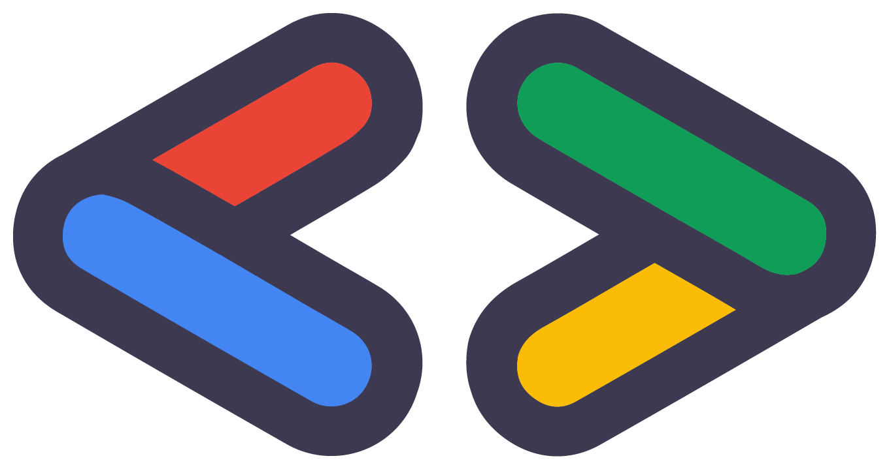

<div align="center">
  
  
  # ⚡ CHATOOOR — The Challenge Arena
  
  **Gamified Competitive Coding & CTF Platform for Google Developer Groups on Campus (GDGC Batna · Univ. Batna 2)**

  [](https://nextjs.org/)
  [](https://react.dev/)
  [](https://www.typescriptlang.org/)
  [](https://tailwindcss.com/)
  [](https://tanstack.com/query)
  [](LICENSE)

  <br />

  <p align="center">
    <b>CHATOOOR</b> is a high-performance, gamified platform built for university developers and cyber-competitors. It unifies <b>Problem Solving (PS)</b>, <b>Cybersecurity (CTF)</b>, and <b>Artificial Intelligence (AI/ML)</b> challenges into a single competitive arena with real-time scoring, rankings, and an organizer command center.
  </p>
</div>

---

## 🌟 Key Features

### 🎮 The Arena (Participant Experience)
- **Multi-Track Challenges**:
  - 🧩 **Problem Solving (PS)**: Algorithmic challenges with code repository/link submissions.
  - 🚩 **Cybersecurity (CTF)**: Interactive flag submissions (`FLAG{...}`) with immediate validation, concurrency double-spending prevention, and point celebrations.
  - 🤖 **Artificial Intelligence (AI/ML)**: Model training and notebook verification challenges.
- **Dynamic Leaderboard**:
  - Live ranking updates based on points earned and completion speed.
  - Player tier progression (from *Rookie* to *Legend*).
  - Custom color-coded player initials, avatar hues, and point differentials.
- **Interactive Submission Modals**:
  - Clean modals with track badges, difficulty indicators, hints disclosure, and live feedback.
  - Submission history timeline per challenge.
- **🌓 Dynamic Theme System**:
  - Instant toggle between high-contrast **Dark Mode** and crisp **Light Mode**.
  - Built with custom CSS design tokens (`--bg`, `--fg`, `--ln`, `--btn`) and zero flash-of-unstyled-theme (`FOUC`).
- **📱 Responsive by Design**:
  - Tailored experiences across Desktop, Tablet, and Mobile.
  - Mobile bottom navigation bar and gesture-ready slide-over panels.

---

### 🛡️ Admin Command Center
- **Strict Role-Based Access Control**:
  - Instant client-side redirect guard ensuring regular participants cannot view administrative views.
  - Automated authentication session watch.
- **Challenge Management (`/dashboard/challenges`)**:
  - Create, view, filter, and edit challenges across all tracks.
  - Active/Inactive toggle (`isActive`) to schedule or unpublish challenges in real-time.
  - Automatic points and difficulty tagging.
- **Submissions Management (`/dashboard/submissions`)**:
  - Review non-CTF submissions (pending/accepted/rejected).
  - Manual point grading with automatic leaderboard synchronization.
  - External link sanitization to prevent unsafe URI schemes.
- **Participants Management (`/dashboard/users`)**:
  - Monitor registered members, track individual points, and inspect user activity.

---

## 🏗️ Tech Stack & Architecture

| Layer | Technologies |
| :--- | :--- |
| **Framework** | [Next.js 16.4.6](https://nextjs.org/) (App Router, Turbopack) |
| **Library** | [React 19.0.0](https://react.dev/) |
| **Language** | [TypeScript 5.7](https://www.typescriptlang.org/) (Strict Mode) |
| **Styling** | [Tailwind CSS v4](https://tailwindcss.com/) & Native CSS Variables Design System |
| **State & Cache** | [TanStack React Query v5](https://tanstack.com/query) with optimistic mutations |
| **Icons & UI** | [Lucide React](https://lucide.dev/), `react-hot-toast` |
| **Fonts** | Google Sans Flex / Outfit (`--fu`), Unbounded (`--fd`), JetBrains Mono (`--fm`), IBM Plex Sans Arabic (`--far`) |
| **HTTP Client** | [Axios](https://axios-http.com/) with cookie-based JWT credentials (`withCredentials: true`) |

---

## 📁 Project Structure

```text
chatoor-front/
├── app/
│   ├── (auth)/
│   │   ├── login/page.tsx             # Player login screen
│   │   └── register/page.tsx          # Account creation with password strength meter
│   ├── challenges/page.tsx            # Main challenge arena
│   ├── community/page.tsx             # GDGC Batna community portal
│   ├── dashboard/                     # Admin Command Center
│   │   ├── challenges/page.tsx        # Challenge creation & status management
│   │   ├── submissions/page.tsx       # Submission review & manual grading
│   │   └── users/page.tsx             # Participant roster & user management
│   ├── leaderboard/page.tsx           # Live global leaderboard
│   ├── resources/page.tsx             # Developer documentation & learning materials
│   ├── globals.css                    # CSS design system, typography & color tokens
│   ├── layout.tsx                     # Root layout, fonts, and metadata
│   ├── AuthContext.tsx                # Authentication state & session watcher
│   └── Providers.tsx                  # React Query & Toast providers
├── components/
│   ├── admin/                         # AdminShell, ChallengesAdminView, SubmissionsView, ParticipantsView
│   ├── auth/                          # AuthScreen, AuthFields, useAuthForm (validation rules)
│   ├── game/                          # ChallengesView, QuestCard, SubmissionModal, LeaderboardView
│   ├── landing/                       # Hero section, Makers modal, Slide-over registration
│   ├── layout/                        # Navbar, Chrome, Footer, RequireAuth
│   └── ui/                            # Icon helper (Lucide mapping), Toast notifications
├── lib/
│   ├── api.ts                         # Axios instance & frozen API contract
│   ├── game.ts                        # Client game derivation (tiers, hues, ranks, calculations)
│   ├── theme.ts                       # Theme state persistence (dark/light)
│   └── useData.ts                     # React Query custom hooks
├── public/                            # Logos, badges, and static branding assets
├── .env.example                       # Example environment variables
├── next.config.ts                     # Next.js build configuration
└── package.json                       # Dependencies and project scripts
```

---

## 🚀 Getting Started

### Prerequisites
- **Node.js**: `v20.x` or `v22.x` (LTS recommended)
- **Package Manager**: `npm` (v10+), `yarn`, or `pnpm`
- **Backend API**: Running CHATOOOR backend instance (NestJS)

### 1. Clone the repository
```bash
git clone https://github.com/soheibdev/chatoor.git
cd chatoor
```

### 2. Install dependencies
```bash
npm install
```

### 3. Configure Environment Variables
Copy `.env.example` to `.env.local`:
```bash
cp .env.example .env.local
```

Configure your environment settings in `.env.local`:
```bash
# URL of your NestJS backend
NEXT_PUBLIC_API_BASE=http://localhost:4000

# Set to 1 for client-side demo mode (mocked data), or 0 for live backend API
NEXT_PUBLIC_DEMO=0
```

### 4. Run the development server
```bash
npm run dev
```

Open [http://localhost:3000](http://localhost:3000) in your browser.

---

## 🛠️ Build & Deployment

### Production Build
Create an optimized production build using Turbopack:
```bash
npm run build
```

### Start Production Server
```bash
npm run start
```

### Deploy to Vercel
The easiest way to deploy CHATOOOR Frontend is using the [Vercel Platform](https://vercel.com/new):
1. Connect your GitHub repository.
2. Add `NEXT_PUBLIC_API_BASE` in the Vercel Environment Variables dashboard.
3. Deploy!

---

## 🔒 Security Highlights

- **Cookie-Based Authentication**: Uses HttpOnly, Secure, SameSite JWT cookies for maximum session security.
- **Frontend Authorization Guard**: Client-side Admin Shell protection redirects regular participants to `/challenges` without UI flash.
- **XSS & Protocol Sanitization**: All external repository URLs and links are validated against `http:` / `https:` schemes and rendered with `rel="noopener noreferrer"`.
- **Password Complexity Enforcement**: Client-side validation matches backend security rules (minimum 8 characters, uppercase, lowercase, numbers, and symbols).

---

## 👥 Credits & Acknowledgements

Developed with passion by the **Google Developer Groups on Campus (GDGC)** Core Team at **University of Batna 2, Algeria**.

- **Organization**: [Google Developer Groups on Campus — Univ. Batna 2](https://gdgbatna.com)
- **Maintainer**: [@soheibdev](https://github.com/soheibdev)

---

<div align="center">
  <sub>Built with ❤️ by GDGC Batna · Coding for the future.</sub>
</div>
